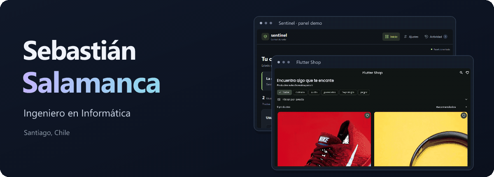
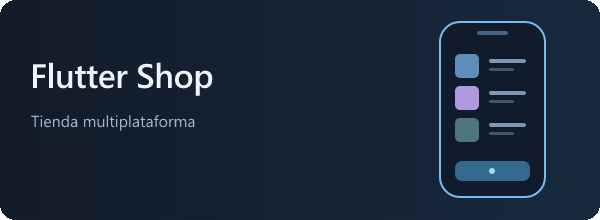
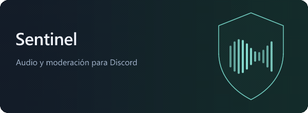
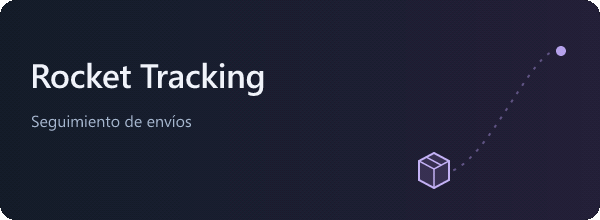
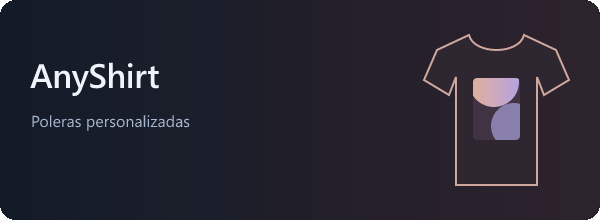

  <picture><source media="(prefers-reduced-motion: reduce)" srcset="assets/profile-banner.png" /></picture>
    
  
Desarrollo aplicaciones web y móviles.

  
Titulado de <b>Duoc UC</b>, con certificación en <b>Ciencia de Datos</b>.

   
  
  &nbsp;
  
  &nbsp;
  
    
  
<a href="#proyectos-destacados">Proyectos</a> &nbsp; / &nbsp; <a href="#tecnologias">Tecnologías</a> &nbsp; / &nbsp; <a href="#experiencia">Experiencia</a> &nbsp; / &nbsp; <a href="#formacion">Formación</a>

 

<h2 align="center">Proyectos destacados</h2>

<table>
<tr>
<td width="50%" valign="top">
  <a href="https://github.com/Brasther/Flutter_Shop"><picture><source media="(prefers-reduced-motion: reduce)" srcset="assets/project-flutter.svg" /></picture></a>
  
Tienda con catálogo, carrito y administración. Backend en Firebase con validación de inventario e integración de pagos.

  
<code>Flutter</code> <code>Dart</code> <code>Firebase</code> <code>Stripe</code>

  
<a href="https://github.com/Brasther/Flutter_Shop#readme">Código</a>

  
Demo de catálogo; los pagos requieren configurar el backend.

</td>
<td width="50%" valign="top">
  <a href="https://github.com/Brasther/sentinel-discord-bot"><picture><source media="(prefers-reduced-motion: reduce)" srcset="assets/project-sentinel.svg" /></picture></a>
  
Bot de Discord que analiza audio localmente y muestra la actividad de voz en un panel web.

  
<code>Python</code> <code>Flask</code> <code>DSP</code> <code>Socket.IO</code>

  
<a href="https://github.com/Brasther/sentinel-discord-bot#readme">Código</a> · <a href="https://github.com/Brasther/sentinel-discord-bot#vista-del-panel">Ver panel</a>

  
Demo local. Detección heurística; puede producir falsos positivos.

</td>
</tr>
<tr>
<td width="50%" valign="top">
  <a href="https://github.com/Brasther/Poyecto-Rocket-2.0-Django"><picture><source media="(prefers-reduced-motion: reduce)" srcset="assets/project-rocket.svg" /></picture></a>
  
Prototipo de seguimiento de envíos con autenticación, validación en servidor y control de permisos.

  
<code>Django</code> <code>SQLite</code> <code>Bootstrap</code> <code>Webpay</code>

  
<a href="https://github.com/Brasther/Poyecto-Rocket-2.0-Django#readme">Código</a>

  
Proyecto académico; pagos en el entorno de integración de Transbank.

</td>
<td width="50%" valign="top">
  <a href="https://anyshirt.cl"><picture><source media="(prefers-reduced-motion: reduce)" srcset="assets/project-anyshirt.svg" /></picture></a>
  
Desarrollo de frontend y backend de una tienda de poleras personalizadas, con personalización DTF y diseño 3D.

  
<a href="https://anyshirt.cl">Sitio web</a>

  
Práctica profesional · 2026.

</td>
</tr>
</table>

 

<h2 align="center">Tecnologías</h2>

  
  
  
  
  
  
  
  
  
  
  
  

 

<h2 align="center">Experiencia</h2>

| Período | Proyecto y contribución |
| :--- | :--- |
| **Jun – sep 2026** | **Lial Services · Intranet corporativa** Visualización de documentos PDF, OCR y experiencia móvil mediante PWA. Laravel, React y Tailwind; pruebas con Playwright y Vitest. |
| **2026** | **AnyShirt · Práctica profesional** Desarrollo de frontend y backend de una tienda de productos personalizados. |
| **2025** | **AulaTrack · Proyecto de titulación en equipo** Digitalización del libro de clases: roles, cursos, asistencia, notas, anotaciones e informes PDF. Python y Django; la versión pública actual usa SQLite y es un prototipo académico. |

 

<h2 align="center">Formación</h2>
<table width="100%">
<tr>
<td width="50%" align="center" valign="top">
   
  <h3>Ingeniería en Informática</h3>
  
Duoc UC · Titulado, 2026

</td>
<td width="50%" align="center" valign="top">
   
  <h3>Ciencia de Datos</h3>
  
Certificación · Duoc UC

</td>
</tr>
</table>

 

  <h3>Contacto</h3>
  
<a href="https://linkedin.com/in/sebastian-salamanca">LinkedIn</a> &nbsp; · &nbsp; <a href="mailto:sebastiansalamanca274@gmail.com">sebastiansalamanca274@gmail.com</a>

