

  
    
  
<b>Desarrollo aplicaciones web y móviles, conectando interfaces, lógica de negocio y datos.</b>

  
Ingeniero titulado de <b>Duoc UC</b> · Certificación en <b>Ciencia de Datos</b> · Santiago, Chile

   
  
  &nbsp;
  
  &nbsp;
  
    
  
<a href="#proyectos-destacados">Proyectos</a> &nbsp; / &nbsp; <a href="#tecnologias">Tecnologías</a> &nbsp; / &nbsp; <a href="#experiencia">Experiencia</a> &nbsp; / &nbsp; <a href="#formacion">Formación</a>

 

<h2 align="center">Proyectos destacados</h2>

Una selección de aplicaciones, prototipos y trabajo profesional.

<table>
<tr>
<td width="50%" valign="top">
  <a href="https://github.com/Brasther/Flutter_Shop">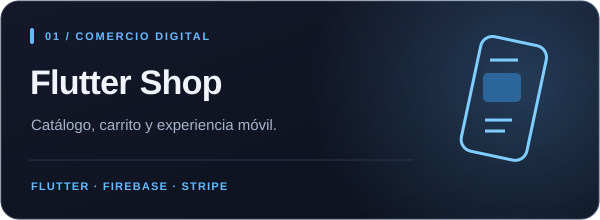</a>
  
Catálogo, favoritos, carrito y administración. Backend con Cloud Functions, validación de inventario e integración de pagos.

  
<code>Flutter</code> <code>Dart</code> <code>Firebase</code> <code>Stripe</code>

  
<a href="https://github.com/Brasther/Flutter_Shop#readme"><b>Explorar proyecto ↗</b></a>

  
Modo invitado para explorar el catálogo. Los pagos requieren configurar el backend.

</td>
<td width="50%" valign="top">
  <a href="https://github.com/Brasther/sentinel-discord-bot">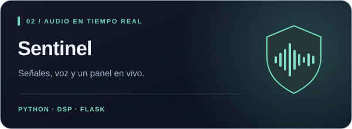</a>
  
Análisis local de señales de audio, detección de voz y calibración por ambiente, con un panel web en tiempo real.

  
<code>Python</code> <code>Flask</code> <code>DSP</code> <code>Socket.IO</code>

  
<a href="https://github.com/Brasther/sentinel-discord-bot#readme"><b>Explorar proyecto ↗</b></a> · <a href="https://github.com/Brasther/sentinel-discord-bot#vista-del-panel">Ver panel</a>

  
Demo local disponible. La detección es heurística y puede producir falsos positivos.

</td>
</tr>
<tr>
<td width="50%" valign="top">
  <a href="https://github.com/Brasther/Poyecto-Rocket-2.0-Django">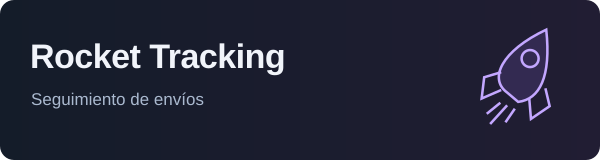</a>
  
Creación y seguimiento de envíos con autenticación, validación en servidor y vistas protegidas por permisos.

  
<code>Django</code> <code>SQLite</code> <code>Bootstrap</code> <code>Webpay</code>

  
<a href="https://github.com/Brasther/Poyecto-Rocket-2.0-Django#readme"><b>Explorar proyecto ↗</b></a>

  
Prototipo académico. El flujo de pago utiliza el entorno de integración de Transbank.

</td>
<td width="50%" valign="top">
  <a href="https://anyshirt.cl">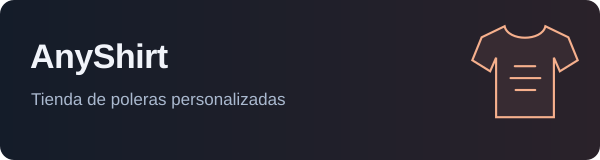</a>
  
Desarrollo de frontend y backend de una tienda de poleras personalizadas, con personalización DTF y diseño 3D.

  
<code>E-commerce</code> <code>Frontend</code> <code>Backend</code>

  
<a href="https://anyshirt.cl"><b>Visitar sitio ↗</b></a>

  
Práctica profesional · 2026.

</td>
</tr>
</table>

 

<h2 align="center">Tecnologías</h2>

Herramientas utilizadas en mis proyectos públicos y experiencia corporativa.

  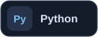
  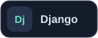
  
  
  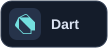
  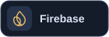
  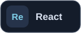
  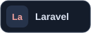
  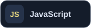
  
  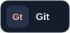
  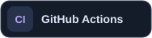

Python y Flutter en proyectos públicos · Laravel, React y Tailwind en la intranet corporativa · NumPy, SciPy y WebRTC VAD en Sentinel

 

<h2 align="center">Experiencia</h2>

| Período | Proyecto y contribución |
| :--- | :--- |
| **Jun – sep 2026** | **Lial Services · Intranet corporativa** Visualización de documentos PDF, OCR y experiencia móvil mediante PWA. Laravel, React y Tailwind; pruebas con Playwright y Vitest. |
| **2026** | **AnyShirt · Práctica profesional** Desarrollo de frontend y backend de una tienda de productos personalizados. |
| **2025** | **AulaTrack · Proyecto de titulación en equipo** Digitalización del libro de clases: roles, cursos, asistencia, notas, anotaciones e informes PDF. Python y Django; la versión pública actual usa SQLite y es un prototipo académico. |

 

<h2 align="center">Formación</h2>
<table width="100%">
<tr>
<td width="50%" align="center" valign="top">
   
  <h3>Ingeniería en Informática</h3>
  
Duoc UC · Titulado, 2026

</td>
<td width="50%" align="center" valign="top">
   
  <h3>Ciencia de Datos</h3>
  
Certificación · Duoc UC

</td>
</tr>
</table>

 

  <h3>Conversemos</h3>
  
Para conocer más de mis proyectos o conversar sobre oportunidades de desarrollo de software.

  
<a href="https://linkedin.com/in/sebastian-salamanca">LinkedIn</a> &nbsp; · &nbsp; <a href="mailto:sebastiansalamanca274@gmail.com">sebastiansalamanca274@gmail.com</a>

   
  

