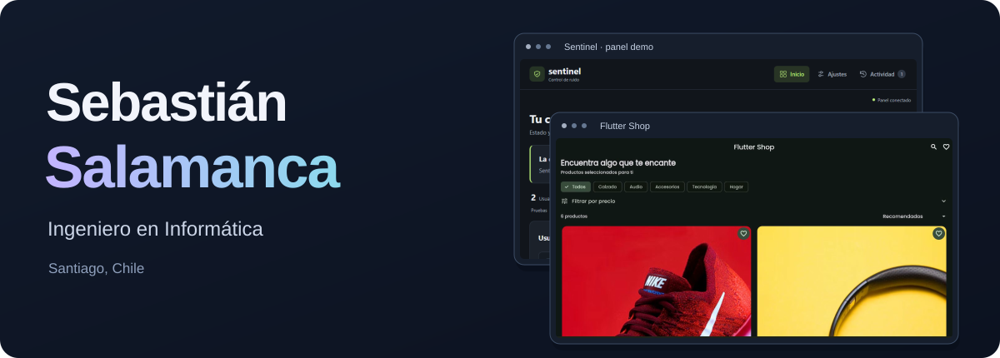

  

  
<a href="#proyectos-seleccionados">Proyectos</a> · <a href="#experiencia">Experiencia</a> · <a href="#formación">Formación</a> · <a href="#contacto">Contacto</a>

Soy **Sebastián Salamanca**, ingeniero en Informática titulado de **Duoc UC**, con certificación en **Ciencia de Datos**. Estoy en Santiago, Chile.

Desarrollo aplicaciones web y móviles. En mis proyectos públicos trabajo con Python, Django, Flask y Flutter: desde gestión académica y seguimiento de envíos hasta comercio electrónico y procesamiento de audio. Me interesa conectar interfaces, lógica de negocio y datos en aplicaciones que se puedan instalar, explorar y entender.

## Proyectos seleccionados

### [Flutter Shop](https://github.com/Brasther/Flutter_Shop)

**Tienda multiplataforma con Flutter, Firebase y Stripe.**

- Catálogo, búsqueda, favoritos, carrito y herramientas de administración.
- Cloud Functions para validar precios, inventario y pagos; reglas de acceso en Firestore.
- Modo invitado para explorar el catálogo de demostración y automatización con GitHub Actions.

**Tecnologías:** Dart · Flutter · Firebase Authentication · Firestore · Cloud Functions · Stripe

[Ver código e instalación](https://github.com/Brasther/Flutter_Shop#readme)

> Los pagos y pedidos requieren configurar el backend. El modo demo permite explorar el catálogo sin presentar pagos simulados como operaciones reales.

### [Sentinel](https://github.com/Brasther/sentinel-discord-bot)

**Bot de Discord para observar audio y apoyar la moderación de canales de voz.**

- Procesamiento local de señales, detección de actividad de voz y calibración por ambiente.
- Panel web con niveles por usuario, ajustes y eventos en tiempo real.
- Demo del panel con datos simulados e instalación guiada para Windows.

**Tecnologías:** Python · discord.py · NumPy · SciPy · WebRTC VAD · Flask · Socket.IO · SQLite

[Ver código y captura del panel](https://github.com/Brasther/sentinel-discord-bot#vista-del-panel) · [Guía de instalación](https://github.com/Brasther/sentinel-discord-bot/blob/main/docs/INSTALACION_WINDOWS.md)

> La detección es heurística y puede producir falsos positivos. Incluye un modo de observación para revisar el comportamiento antes de activar medidas automáticas.

### [Rocket Tracking](https://github.com/Brasther/Poyecto-Rocket-2.0-Django)

**Prototipo académico para crear envíos y consultar su seguimiento.** Incluye autenticación, validación en servidor, vistas con permisos y un flujo de pago Webpay Plus en entorno de integración.

**Tecnologías:** Python · Django · SQLite · JavaScript · Bootstrap · Transbank SDK

[Ver código e instalación](https://github.com/Brasther/Poyecto-Rocket-2.0-Django#readme)

## Experiencia

**Lial Services · Intranet corporativa**

Junio – septiembre de 2026

Desarrollo de una intranet con visualización de documentos PDF, OCR y experiencia móvil mediante PWA. Trabajo con Laravel, React y Tailwind, y pruebas con Playwright y Vitest.

**AnyShirt · Práctica profesional**

2026

Desarrollo de frontend y backend de una tienda de poleras personalizadas, con personalización DTF y diseño 3D.

[Visitar AnyShirt](https://anyshirt.cl)

**AulaTrack · Proyecto de titulación en equipo**

2025

Sistema de gestión académica para digitalizar el libro de clases: usuarios y roles, cursos, asistencia, notas, anotaciones e informes PDF. Desarrollado con Python y Django; la versión pública actual utiliza SQLite y se presenta como prototipo académico.

## Tecnologías en mis proyectos

| Área | Tecnologías y contexto |
| --- | --- |
| Backend web | Python, Django y Flask en Rocket Tracking, AulaTrack y Sentinel |
| Aplicaciones móviles y web | Flutter y Dart en Flutter Shop |
| Interfaces web | JavaScript, HTML y CSS; React y Tailwind en experiencia corporativa |
| Persistencia y servicios | SQLite, Firebase Authentication y Cloud Firestore |
| Audio y datos numéricos | NumPy, SciPy y WebRTC VAD en Sentinel |
| Herramientas | Git, GitHub Actions; Playwright y Vitest en la intranet corporativa |

## Formación

- **Ingeniería en Informática · Duoc UC.** Titulado, 2026.
- **Certificación en Ciencia de Datos · Duoc UC.** Formación complementaria a mis proyectos de desarrollo de software.

## Contacto

Puedes escribirme para conversar sobre mis proyectos y oportunidades de desarrollo de software.

[LinkedIn](https://linkedin.com/in/sebastian-salamanca) · [Correo](mailto:sebastiansalamanca274@gmail.com) · [GitHub](https://github.com/Brasther)
